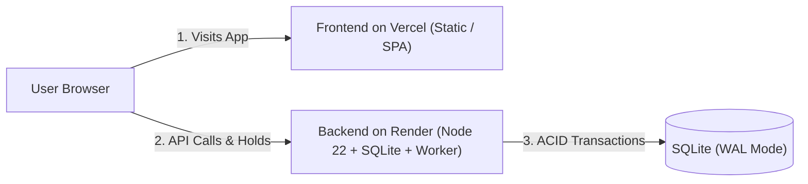

# 🚀 EventNest: Vercel (Frontend) & Render (Backend) Deployment Guide

This guide walks you through deploying **EventNest** with the **frontend hosted on Vercel** and the **backend API hosted on Render**.

---

## 🌟 Architecture Overview



---

## 🛠️ Step 1: Deploy Backend to Render

### Option A: Using the 1-Click Render Blueprint (`render.yaml`)
1. Push your repository to **GitHub**.
2. Log into [Render.com](https://dashboard.render.com).
3. Click **New +** → **Blueprint**.
4. Select your **Event-Management** GitHub repository.
5. Render reads [`render.yaml`](file:///d:/WT%20Project/Event-Management/render.yaml) automatically:
   - **Service Name**: `eventnest-backend`
   - **Build Command**: `npm install`
   - **Start Command**: `node backend/server.js`
   - **Health Check Path**: `/api/health`
6. Click **Apply**.
7. Once deployed, Render will provide your public backend URL, for example:
   ```
   https://eventnest-backend.onrender.com
   ```
8. Verify it by visiting:
   ```
   https://eventnest-backend.onrender.com/api/health
   ```
   You should see: `{"status":"ok","service":"eventnest-backend",...}`

### Option B: Manual Web Service Setup on Render
1. In Render Dashboard, click **New +** → **Web Service**.
2. Connect your GitHub repository.
3. Configure the following fields:
   - **Name**: `eventnest-backend`
   - **Region**: Choose closest to your audience (e.g., Singapore, Oregon, Frankfurt)
   - **Branch**: `main`
   - **Root Directory**: Leave blank (or `./`)
   - **Runtime**: `Node`
   - **Build Command**: `npm install`
   - **Start Command**: `node backend/server.js`
   - **Instance Type**: `Free`
4. Click **Create Web Service**.

> [!TIP]
> **Data Persistence on Render Free Tier:**
> SQLite stores data in `reservation_system.db`. On Render's Free tier, the filesystem is ephemeral (resets on redeploy). For persistent production storage, you can attach a Render **Persistent Disk** mounted at `/data` and set `DB_PATH=/data/reservation_system.db` in Environment Variables.

---

## 🌐 Step 2: Deploy Frontend to Vercel

1. Log into [Vercel.com](https://vercel.com).
2. Click **Add New...** → **Project**.
3. Import your **Event-Management** GitHub repository.
4. In the Project Configuration screen:
   - **Framework Preset**: Select **Other**.
   - **Root Directory**: Click *Edit* and select **`frontend`** (or leave as root, since [`vercel.json`](file:///d:/WT%20Project/Event-Management/vercel.json) routes to `frontend`).
   - **Build and Output Settings**: Leave empty (No build step required for static HTML/CSS/JS).
5. Click **Deploy**.
6. In a few seconds, Vercel will give you your live URL, e.g.:
   ```
   https://eventnest.vercel.app
   ```

---

## 🔗 Step 3: Connect Frontend to Backend

EventNest features built-in cross-origin API connection handling:

1. Open your live Vercel URL in your browser: `https://your-project.vercel.app`.
2. In the top-right header, click the **Backend: Auto** (or ⚙️ gear icon) button.
3. Paste your Render backend URL:
   ```
   https://eventnest-backend.onrender.com
   ```
4. Click **Test Connection**. You will see:
   > `✓ Connected! Server uptime: ...s (SQLite ready)`
5. Click **Save & Connect**.
6. The app will immediately link to your Render backend, refresh live events, and start handling real-time reservation holds, concurrency stress tests, and organizer analytics!

---

## 🧪 Testing Your Deployed System

Once both are deployed, test these edge cases directly from the Vercel UI:
1. **Persona Switcher**: Switch to *Sarah Connor* and create a new event with multiple ticket tiers.
2. **10-Minute Cart Hold**: Switch to *Alice Johnson*, reserve 2 tickets, and observe the live countdown timer.
3. **Checkout Simulation**: Complete mock checkout to generate an order receipt, or test payment decline (402) rollback.
4. **Concurrency Stress Test**: Navigate to **Concurrency Stress Test Lab**, set 15 concurrent buyers, and watch atomic locking prevent double-booking live in production!
5. **Background Worker Sweep**: Open **System Diagnostics** to observe the worker automatically recovering expired seats every 5 seconds.
