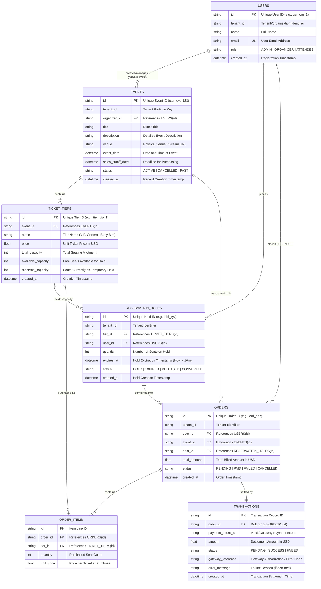

# Entity-Relationship (ER) Diagram & Data Architecture

## 1. System Overview
The **EventNest** multi-tenant ticket reservation platform ensures high-concurrency seat reservation integrity using ACID-compliant exclusive write transactions (`BEGIN IMMEDIATE` in SQLite / `SELECT FOR UPDATE` in PostgreSQL), temporary 10-minute reservation holds, an in-memory/Redis read caching layer, and an asynchronous background worker that automatically returns expired holds to available inventory.

---

## 2. Mermaid Entity-Relationship Diagram



---

## 3. Data Dictionary & Constraints

| Table Name | Column | Type | Constraints | Description |
| :--- | :--- | :--- | :--- | :--- |
| `users` | `id` | `TEXT` | PRIMARY KEY | User identifier |
| `users` | `tenant_id` | `TEXT` | NOT NULL | Multi-tenant organization scoping |
| `users` | `email` | `TEXT` | UNIQUE, NOT NULL | Account contact |
| `users` | `role` | `TEXT` | CHECK in ('ADMIN', 'ORGANIZER', 'ATTENDEE') | Role-based authorization |
| `events` | `id` | `TEXT` | PRIMARY KEY | Event identifier |
| `events` | `organizer_id`| `TEXT` | FOREIGN KEY (`users.id`) | Event owner |
| `events` | `sales_cutoff_date` | `TEXT` | NOT NULL | Automatic cutoff gating bookings |
| `ticket_tiers`| `id` | `TEXT` | PRIMARY KEY | Tier identifier |
| `ticket_tiers`| `event_id` | `TEXT` | FOREIGN KEY (`events.id`) | Associated event |
| `ticket_tiers`| `available_capacity`| `INTEGER` | NOT NULL | Decremented atomically upon hold |
| `ticket_tiers`| `reserved_capacity` | `INTEGER` | DEFAULT 0 | Count of currently held seats |
| `reservation_holds` | `id` | `TEXT` | PRIMARY KEY | Hold reference |
| `reservation_holds` | `expires_at` | `TEXT` | NOT NULL | 10 minutes from creation |
| `reservation_holds` | `status` | `TEXT` | CHECK in ('HOLD', 'EXPIRED', 'RELEASED', 'CONVERTED') | Hold lifecycle flag |
| `orders` | `id` | `TEXT` | PRIMARY KEY | Order reference |
| `orders` | `status` | `TEXT` | CHECK in ('PENDING', 'PAID', 'FAILED', 'CANCELLED') | Order state |
| `transactions` | `id` | `TEXT` | PRIMARY KEY | Settlement reference |
| `transactions` | `order_id`| `TEXT` | FOREIGN KEY (`orders.id`) | Associated order |
| `transactions` | `status` | `TEXT` | CHECK in ('PENDING', 'SUCCESS', 'FAILED') | Payment gateway result |

---

## 4. State Lifecycle Models

### A. Reservation Hold Lifecycle
```
[User Selects Seats] 
       │
       ▼
 [HOLD CREATED] ─────────── (10 Minutes Pass / Worker Sweep) ───────► [EXPIRED]
       │                                                                  │
       │ (Checkout Complete)                                              ▼
       ├─────────────────────► [CONVERTED] ────────► [ORDER PAID]    (Inventory
       │                                                              Restored)
       ▼ (User Cancels or Payment Declines)
  [RELEASED] ─────────────────────────────────────────────────────────────┘
```

### B. Concurrency Double-Booking Protection Mechanism
1. When multiple booking requests hit the server concurrently for the same limited inventory:
2. The transaction acquires an immediate lock via `BEGIN IMMEDIATE`.
3. Reads `available_capacity` inside the lock.
4. If `available_capacity < requested`: immediately rolls back and returns `409 Conflict`.
5. If sufficient: decrements `available_capacity`, increments `reserved_capacity`, inserts hold record with `expires_at = now + 10m`, and commits.
6. This guarantees total allocated seats strictly equals available capacity with **0 race conditions**.
