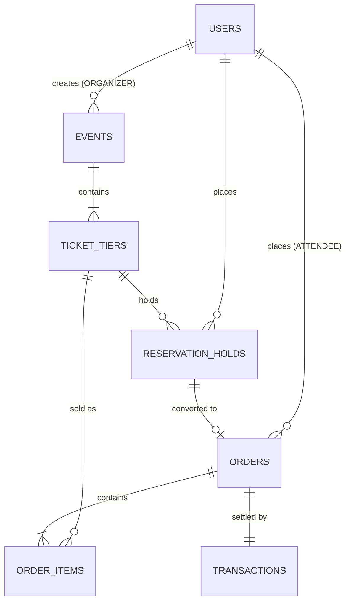

# 🎟️ EventNest: Multi-Tenant Event & Ticket Reservation System

EventNest is a high-concurrency, multi-tenant event management and ticket reservation system engineered to eliminate double-booking race conditions while providing a simple, responsive, and intuitive experience.

---

## 🌟 Highlights & Architecture Breakdown

### 1. Concurrency Protection & ACID Transactions
- **Atomic Hold Allocation**: Employs SQLite `BEGIN IMMEDIATE` exclusive writer transactions (and compatible with PostgreSQL `SELECT FOR UPDATE` / Redis distributed locks).
- **Zero Double-Booking Guarantee**: Inventory validation and decrement occur inside the exclusive transaction boundary. When 15 concurrent users contest the last 2 seats, exactly 2 succeed and 13 receive immediate HTTP `409 Conflict` responses without phantom reads or inventory deficits.

### 2. 10-Minute Temporary Reservation Holds
- Attendees hold seats for **10 minutes** before completing checkout.
- Active countdown timer in the UI displays real-time seconds remaining and an animated progress bar.
- If checkout is not completed within 10 minutes, seats are automatically returned to available inventory.

### 3. Role-Based Access Control (RBAC) & Multi-Tenancy
- **Admin (`ADMIN`)**: Platform-wide metrics, background worker controls, and caching diagnostics.
- **Organizer (`ORGANIZER`)**: Multi-tenant event creation, tiered ticket pricing and capacity configuration, real-time revenue analytics, and hold-to-buy conversion rate tracking.
- **Attendee (`ATTENDEE`)**: Public event browsing, tier selection, 10-minute temporary holds, and simulated checkout.

### 4. Background Queue / Worker
- Built-in asynchronous worker (`worker.js`) polls every 5 seconds (or cron).
- Finds expired holds (`status = 'HOLD' AND datetime(expires_at) <= datetime('now')`).
- Atomically reverts `status = 'EXPIRED'`, restores ticket inventory, and clears event caches.

### 5. Multi-Tier Caching Layer
- High-speed in-memory TTL caching with optional drop-in Redis support (`REDIS_URL`).
- Caches active event catalog and ticket tier listings for ultra-fast read throughput.
- Event cache keys are surgically invalidated whenever holds are placed, checked out, expired, or modified.

### 6. Payment Gateway Simulation
- `/api/checkout` and `/api/payments/mock-gateway` endpoints simulate asynchronous payment processing with instant approval or failure testing.
- If payment succeeds: order status becomes `PAID`, hold converts to `CONVERTED`, transaction recorded.
- If payment fails: order marked `FAILED`, transaction recorded, and hold is released back to available inventory.

---

## 📊 Deliverable 1: Entity-Relationship (ER) Diagram

A dedicated document is provided in [ERD.md](file:///e:/Bala/ERD.md).



---

## 📮 Deliverable 2: Postman Collection

The exportable Postman Collection v2.1.0 file is located at:
[`event_reservation_system.postman_collection.json`](file:///e:/Kavin/event_reservation_system.postman_collection.json)

### Tested Edge Cases:
1. **RBAC Edge Case**: Attendee blocked from creating events (`403 Forbidden`).
2. **Caching**: First hit loads from database, subsequent hits serve from cache.
3. **10-Minute Hold Lifecycle**: Hold creation, timer inspection, and manual release.
4. **Checkout Edge Cases**:
   - Successful checkout with mock payment.
   - Re-checkout of already converted hold (`400 Bad Request`).
   - Payment card decline with automatic inventory restoration (`402 Payment Required`).
   - Expired hold checkout rejection (`410 Gone`).
5. **High-Concurrency Race Condition**: Fires 15 parallel requests simultaneously at the same seat allotment to verify zero double-booking and `409 Conflict` handling.
6. **Worker Sweep**: Immediate manual execution of expired hold sweep.
7. **Organizer Analytics**: Real-time revenue calculations and hold-to-purchase conversion percentage.

---

## 🚀 Deliverable 3: Quick Start & Cloud Deployment

### Run Locally (Ready in under 10 seconds)
```bash
# 1. Install dependencies
npm install

# 2. Start server
npm start
```
Visit your browser at: **`http://localhost:3000`**

### Pre-Seeded Identities
| Persona | User ID | Role | Tenant |
| :--- | :--- | :--- | :--- |
| **Sarah Connor** | `usr_org_1` | `ORGANIZER` | `tenant_acme` (Acme Events) |
| **David Miller** | `usr_org_2` | `ORGANIZER` | `tenant_apex` (Apex Music) |
| **Alice Johnson**| `usr_att_1` | `ATTENDEE` | `tenant_acme` |
| **System Admin** | `usr_admin_1`| `ADMIN` | `tenant_platform` |

### Cloud Deployment Options

#### 1. Render Deployment (1-Click Blueprint)
The project includes a ready-to-deploy [`render.yaml`](file:///e:/Bala/render.yaml):
1. Connect your repository to [Render.com](https://render.com).
2. Choose **Blueprints** and select this repository.
3. Render automatically provisions the web service on Node 22.

#### 2. Docker / Railway / Fly.io
```bash
docker build -t eventnest .
docker run -p 3000:3000 eventnest
```

---

## 🧪 Interactive UI Features
1. **Role Switcher Dropdown**: Instantly switch between Attendee, Organizer, and Admin personas in the header.
2. **Live 10-Minute Countdown Bar**: Real-time ticker and animated meter for active ticket holds.
3. **Interactive Concurrency Stress Test**: Choose a tier, enter parallel buyer count (e.g. 15), and click **Launch Simultaneous Race Test** to watch atomic locking prevent race conditions in real time.
4. **Organizer KPI Dashboard**: Live revenue counter, hold-to-order conversion rate %, and tier breakdown table.
